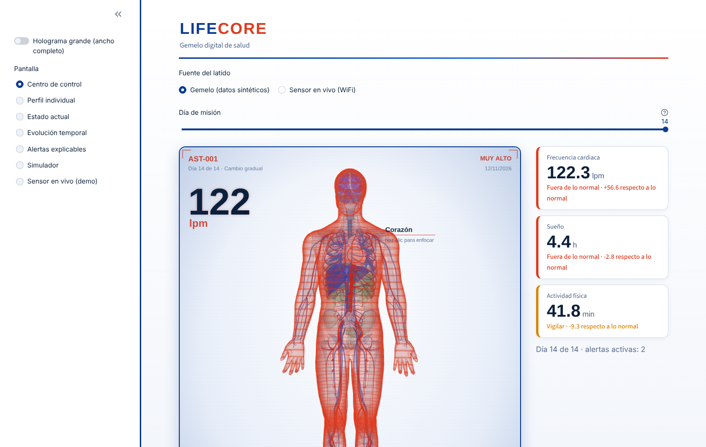
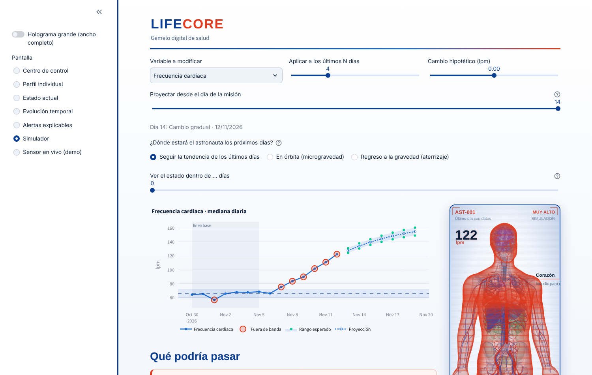

# Lifecore

**An explainable digital twin of an astronaut's health.** Lifecore learns what is *normal for one person*
(heart rate, sleep, activity, SpO₂, temperature), warns when something drifts away from it, forecasts the next 7 days, and shows
the result on a 3D hologram whose heart beats at the measured pulse. A cheap ESP32 + pulse sensor shows how a
real wearable would feed the twin over WiFi.

> **Honesty notes.** The astronaut (AST-001) and all mission data are **synthetic**. The pulse sensor is a hobby
> sensor and the whole project is an educational prototype, **not a medical device**. Reference values come from
> NASA and Mayo Clinic documents and are cited in [docs/nasa-references.md](docs/nasa-references.md).

Built for the NASA Space Apps Challenge. Open source under the MIT license, contributors welcome.



## What it does

| Feature | How it works |
|---|---|
| **Personal baseline** | Median and MAD of the first 7 days, per variable. No one-size-fits-all thresholds. |
| **Explainable alerts** | An alert needs 2+ consecutive days beyond 2.5 robust z-scores, and tells you the value, the normal value and since when. |
| **7-day forecast** | A damped robust trend (Theil-Sen) with an uncertainty band, the estimated day a variable leaves normal, and plain-language possible discomforts. |
| **Gravity scenarios** | Simulator: *keep trend*, *in orbit* (-3 bpm) or *landing* (+38 % on day 1, recovering in about 8 days), based on NASA Shuttle/ISS data. |
| **3D hologram** | Real anatomy (BodyParts3D). The heart beats at the measured rate; click it to zoom. Color follows the heart rate: gray < 60, blue, yellow 90-100, orange, red from 114 bpm. |
| **Live sensor** | ESP32 + XD-58C detects beats and posts them over WiFi; the hologram beats with every received beat. |



## Repository layout

```
lifecore/
├── .streamlit/config.toml   Theme and static-file serving (run Streamlit from this folder)
├── app/                     Streamlit application (the digital twin)
│   ├── app.py               UI: control center, profile, trends, alerts, simulator, live sensor
│   ├── analysis.py          Baseline, alerts, forecast, gravity model (pure pandas/numpy, tested)
│   ├── synthetic_data.py    Generator of the fictional astronaut AST-001
│   ├── hologram.py          Builds the URL of the hologram page
│   └── static/hologram/     Built hologram: index.html, holo.js, 3D models (body.bin, heart.glb)
├── hologram/                Hologram source (Three.js)
│   └── src/entry.js         Scene, shaders, cardiac motion, HUD, live polling
├── receiver/receiver.py     Tiny HTTP server that receives beats from the ESP32 (port 8000)
├── firmware/esp32_wifi/     ESP32 sketch (beat detection + WiFi) and secrets.h.example
├── hardware/                Parts list, wiring and 3D-printable enclosures (stl/)
├── data/synthetic_14_days.csv   Synthetic mission data (labeled as synthetic)
├── tools/build_body.py      Rebuilds the body model from the BodyParts3D atlas
├── tests/test_analysis.py   Automated test cases (see docs/test-cases.md)
├── docs/                    Architecture, NASA references, test cases, images
├── CONTRIBUTING.md  CODE_OF_CONDUCT.md  CREDITS.md  LICENSE
```

How the pieces connect (details in [docs/architecture.md](docs/architecture.md)):

```
XD-58C sensor -> ESP32 (beat detection) --WiFi/HTTP--> receiver.py --/estado--> hologram (live mode)
                                                              |
                                                      data/sensor_log.csv --> Streamlit app
synthetic_data.py -> data/synthetic_14_days.csv -> analysis.py -> Streamlit app -> hologram + charts
```

## Quick start (software only, no hardware needed)

Requires Python 3.10+.

```bash
git clone <this-repository-url>
cd lifecore
pip install -r requirements.txt
streamlit run app/app.py
```

Open http://localhost:8501. Choose **Control center -> Gemelo (datos sintéticos)** and move the *mission day* slider:
the hologram goes from gray (day 3) through blue, yellow and orange to red (day 14). Try the **Simulador** page for the forecast.

Run the tests: `python tests/test_analysis.py` (11 test cases, no extra packages needed).

> The user interface text is in Spanish (the team's language). All documentation and code structure are in English;
> an English UI is a welcome contribution (see [CONTRIBUTING.md](CONTRIBUTING.md)).

## Live sensor demo (ESP32)

1. Build the circuit and print the enclosure: see [hardware/README.md](hardware/README.md).
2. Copy `firmware/esp32_wifi/secrets.h.example` to `secrets.h`, fill in your PC hotspot name and password, and upload the sketch with the Arduino IDE (board: ESP32 Dev Module).
3. Turn on the Windows **Mobile hotspot** and connect the ESP32 to it (the PC is usually `192.168.137.1`).
4. Start the receiver: `python receiver/receiver.py` (use `--simular` to test without the ESP32).
5. In the app choose **Sensor en vivo (WiFi)**, place a finger on the sensor, and wait for about 20 beats to calibrate.

## Hologram development

The built file is committed, so Node.js is only needed if you edit `hologram/src/entry.js`:

```bash
npm install
npm run build        # writes app/static/hologram/holo.js
```

## Limitations

- Synthetic data; one fictional astronaut; no clinical validation.
- The pulse sensor is optical and sensitive to movement, skin and clothing; it needs a bare finger.
- The ECG trace in the hologram is illustrative, generated from the heart rate.
- NASA values are group averages from short Shuttle flights and a small ISS sample. No in-flight absolute numbers were found, so the orbit effect is an assumption.

## Contributing and license

Contributions are welcome: see [CONTRIBUTING.md](CONTRIBUTING.md). Code: [MIT](LICENSE). 3D anatomy: BodyParts3D, CC BY 4.0 ([CREDITS.md](CREDITS.md)).
